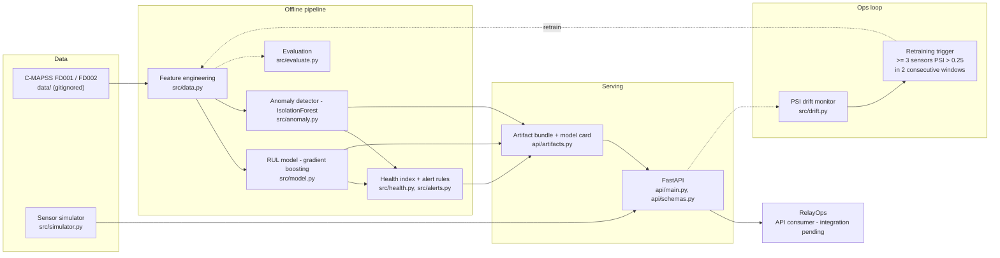

# RelayOps ML — Predictive Maintenance Intelligence

A standalone Python ML service that scores equipment health and
remaining useful life (RUL) for [RelayOps](https://github.com/MuhammadB786/RelayOps)
(a maintenance & reliability platform) and feeds predictions back to it
over an API. This repository is deliberately separate from the RelayOps
web app: the model pipeline is a portfolio-grade, independently
deployable artifact, and integration is API-only.

**Status: Milestones 1–4 complete.** M1 — data pipeline, baseline RUL
model, evaluation against published baselines. M2 — anomaly detection,
a composite health index, a costed alert-threshold decision, and a
generalization run on the harder FD002 subset. M3 — a FastAPI scoring
service serving the trained components from a checksummed artifact
bundle. M4 — a data-derived sensor simulator, a live scoring demo, and
PSI drift monitoring with an evaluated retraining trigger. This case
study is M5; deployment is prepared (`render.yaml`, see *Deploying*)
but not yet performed, and the RelayOps-side integration (predictions
table, worker route, UI) is **not built yet** — it is a separate change
gated on the RelayOps app's own Cloudflare deployment. Nothing below
claims otherwise.

## Case study

### The problem

Unplanned equipment downtime is one of the most expensive failure modes
in asset-intensive operations — industry estimates put it on the order
of $125k/hour median across heavy industries, ~$1T/year globally.
Maintenance teams mostly still react: something breaks, then they
scramble. RelayOps already manages the reactive side (work orders,
assets, sensor readings, preventive plans, audit trail); what it
cannot do today is look ahead — which asset is degrading, how much
life it has left, and when an intervention is worth its cost.

This service is that foresight layer: predicting remaining useful life
from sensor history early enough to schedule the repair. It is built
and evaluated on NASA's C-MAPSS turbofan degradation benchmark, the
public dataset the field uses for exactly this problem, because
published baselines make honest comparison possible — every headline
number below sits next to the published number it should be judged
against. The economics drive the engineering throughout: an hour of
unplanned downtime costs orders of magnitude more than an inspection,
so the alerting decision in M2 is made under an explicit 50:1
missed-failure:false-alarm cost model rather than by maximizing
accuracy.

### What this adds to RelayOps — and the integration contract

For each asset, the service returns a predicted RUL (cycles), a 0–100
health index, an anomaly percentile against healthy behaviour, and an
alert level (`critical` / `watch` / `none`). The contract is HTTP-only:

| Endpoint | Contract |
|---|---|
| `POST /score` | one asset's recent sensor window in → RUL, health, anomaly, alert level out |
| `POST /score/batch` | many assets per call; one bad asset returns a per-item error, never sinks the batch |
| `GET /healthz` | liveness + model version + artifact checksum; unauthenticated |

Scoring endpoints require an `X-API-Key` header when
`RELAYOPS_ML_API_KEY` is set (a shared-secret stub — demo scope, see
Limitations). The boundary is strict in both directions: this
repository never touches RelayOps code or data, and RelayOps will
consume predictions only through this API, storing them in its own
predictions table. The service side of the contract is implemented and
tested (M3); the RelayOps side is pending, per the status note above.

### Architecture



| Component | File(s) | Role |
|---|---|---|
| Data + features | `src/data.py` | C-MAPSS loading, capped RUL labels, engine-level splits, trailing rolling features |
| RUL model | `src/model.py` | HistGradientBoosting regressor + joblib persistence |
| Evaluation | `src/evaluate.py` | RMSE, NASA asymmetric score, last-cycle protocol |
| Anomaly detection | `src/anomaly.py` | IsolationForest on healthy life only; scores, percentiles, lead times |
| Health index | `src/health.py` | Documented 0.6/0.4 composite of RUL and anomaly components |
| Alert decision | `src/alerts.py` | Per-cycle precision/recall, costed threshold sweep |
| Simulator | `src/simulator.py` | Synthetic assets with parameters measured from FD001 + recorded-engine replay |
| Drift monitoring | `src/drift.py` | Per-sensor PSI vs reference, retraining-trigger rule |
| API | `api/main.py`, `api/schemas.py` | `/healthz`, `/score`, `/score/batch`; strict validation, reject-never-repair |
| Artifact bundle | `api/artifacts.py` | Checksummed save/load, fail-fast startup, alert-level mapping |
| Entry points | `scripts/` | `fetch_data.py`, `train.py`, `run_m2.py`, `run_fd002.py`, `train_service.py`, `run_live_demo.py`, `run_drift_eval.py`, `smoke.py` |

The ops loop closes the system: scored production windows feed the
drift monitor, and when the trigger fires the answer is a retrain
through the same pipeline — not a threshold tweak.

### Results at a glance

Every number is copied from `results/` (the appendix names the source
of each); published values are the comparison tables cited in
References.

| Measure | This project | Published reference |
|---|---|---|
| RUL — FD001 test RMSE | **19.61** | DCNN 12.61 · LSTM 16.10 · CNN 18.45 · SVR 20.96 |
| RUL — FD001 test NASA score | **966.678** | DCNN 274 · LSTM 338 · CNN 1287 |
| RUL — FD002 test RMSE / NASA | **27.60 / 8658** | DCNN 22.36 / 10,412 · LSTM 24.49 · CNN 30.29 (RMSE) |
| Alert rule (health ≤ 50) — test precision / recall | **0.165 / 0.994** | best RUL-only rule (≤ 90): 0.114 / 0.985 |
| Anomaly detection — validation median lead time | **140.5 cycles** at 16.0% healthy-cycle false-alarm rate → **64 cycles** at 4.8% (threshold sweep; detection rate 1.00 throughout) | — |
| Live demo — confirmed-critical lead time | **92 cycles** (synthetic asset) · **28 cycles** (FD001 engine 41 replay) | — |
| Drift trigger — detection boundary | fires at **1.0 reference-σ** sustained sensor bias; silent on the unshifted control (health-index PSI 0.0206) and at 0.5σ | — |

The honest summary: the RUL baseline beats the classical SVR and, on
the safety-weighted NASA score, the published CNN — and loses clearly
to every sequence model. The system's value is not the regressor; it
is the composite alerting (which catches the regressor's worst
mistakes), the evaluated operating point, and the monitoring around
it.

### Key decisions

- **RUL labels capped at 125 cycles.** Above the cap an engine is
  effectively healthy and its exact RUL is label noise; the cap
  focuses learning on the degradation regime and follows the published
  convention (R_early = 125), keeping scores comparable. Accepted
  cost: long-RUL predictions are structurally biased low (appendix,
  M1 failure mode 1).
- **Splits by engine, features trailing-only.** No cycle of a
  validation engine is ever trained on, and a row's features depend
  only on its own past — enforced by a test that mutates future rows
  and asserts earlier features do not change. Random row splits would
  leak and flatter every metric in this document.
- **Alert when health ≤ 50, chosen on validation under a 50:1 cost
  model.** Frozen before test evaluation; on test it returns precision
  0.165 / recall 0.994 at the lowest cost of any candidate on both
  sets, and the ranking survives 10:1 and 100:1 sensitivity checks.
  The accepted price is stated with it: about five false-alarm cycles
  per true alert cycle, and 52% of test engines see at least one alert
  while still healthy.
- **Retraining trigger: ≥ 3 sensors with PSI > 0.25 in each of 2
  consecutive windows.** Measured boundary: a sustained 1.0
  reference-σ bias on three sensors fires it (shifted-sensor PSI
  1.18–1.60); 0.5σ does not — it is plainly visible in one window
  (PSI 0.37–0.40) and nearly invisible in the next (0.06–0.09), which
  is exactly the flakiness the persistence rule exists to reject. The
  unshifted control does not fire.
- **The first 10 cycles of any asset are "warming up", never scored.**
  Rolling features over partially filled windows land in a
  feature-space corner that reads as maximally anomalous (mean cycle-1
  anomaly score 0.5897 vs 0.451 settled; 100% of engines above the
  healthy 97.5th percentile at cycle 1). The API enforces it as a
  readable 422, not a silent bad score.

### What failed

- **The FD002 normalization remedy did not transfer.**
  Operating-condition normalization improved FD002 validation (RMSE
  17.70 → 16.16, score 2152 → 1655) and then failed the official test
  (27.60 → 27.72, score 8658 → 13,666): it reduced the count of late
  predictions but made the worst ones worse, and the NASA score is
  decided by that tail. Verdict recorded in M2: not validated.
- **M1's first validation protocol was meaningless — caught and
  replaced.** Scoring run-to-failure engines at their last cycle
  grades predictions where true RUL is 0 by construction. Validation
  now scores at fixed true-RUL horizons (100/75/50/25/10), which is
  why the validation numbers (RMSE 18.69, NASA 1051.427) sit close to
  test instead of flattering the model.
- **M2's detector appeared to fire at birth — an artifact, caught by
  evaluation.** Phantom ~200-cycle median lead times at every
  threshold traced to the partially-filled-window effect above; the
  warm-up exclusion is the fix, and the underlying signal (scores
  rising monotonically as true RUL falls) was re-verified after it.
- **Pooled drift monitoring is composition-sensitive — measured, not
  assumed.** In the unshifted M4 control, sensor_14 reads PSI 1.7235
  with no drift at all: 84.4% of its pooled variance is between-engine,
  so a small window's marginal is mostly a lottery of which engines
  are in it. An earlier design using fraction-of-life windows
  false-fired the trigger on the same control. Cycle-matched windows
  plus the ≥3-sensor × 2-window persistence rule are the mitigations;
  per-asset PSI is the named fix, not yet built.

### Limitations and future work

- **Serving validity is FD001-only.** One operating condition, one
  fault mode. The FD002 result is precisely why `/score` documents
  FD001 validity: a multi-condition fleet would be scored by a model
  never validated there. Per-condition models are the named FD002
  next experiment.
- **Alert metrics are per-cycle, not per-episode.** A persistent alert
  is one inspection episode to an operator but many cycles to the
  metric; episode-level precision/recall remains future work, and the
  operating point inherits the 50:1 cost assumption (sensitivity
  reported; the true ratio is a business decision).
- **Drift monitoring is pooled, not per-asset** — with the composition
  caveat measured in M4 — and PSI is univariate, so a
  correlation-only drift with unchanged marginals is invisible to it.
  Its measured sensitivity floor is ≈ 1 reference-σ of sustained bias.
- **The accuracy gap is sequence models.** LSTM (16.10 / 338) and DCNN
  (12.61 / 274) beat the gradient-boosting baseline by a wide margin;
  a sequence model behind the same API contract is the clearest
  accuracy upgrade available. An uncapped / two-stage RUL variant is
  the cheaper experiment against failure mode 1.
- **RelayOps integration is pending** (predictions table, worker
  route, health surfacing in the UI), gated on the RelayOps app's
  Cloudflare deployment. Auth is a shared-secret stub; the Dockerfile
  is written to spec but not build-verified (no Docker daemon on the
  build machine).

### Reproduce everything

All scripts are deterministic (seed 42; the M4 simulator/demo uses
seed 7). Runtimes are the recorded totals from the results files or
the milestone sections, on a laptop CPU.

```bash
python3 -m venv .venv && .venv/bin/pip install -r requirements.txt
.venv/bin/python scripts/fetch_data.py        # C-MAPSS -> data/ (12.4 MB download, seconds)
.venv/bin/python scripts/train.py             # M1 -> results/metrics.json            (~19 s)
.venv/bin/python scripts/run_m2.py            # M2 -> results/m2_metrics.json + CSVs  (~21 s)
.venv/bin/python scripts/run_fd002.py         # FD002 -> results/fd002_metrics.json   (~101 s)
.venv/bin/python scripts/train_service.py     # M3 bundle -> models/                  (~13 s)
.venv/bin/python scripts/run_live_demo.py     # M4 demo -> results/m4_metrics.json    (~33 s)
.venv/bin/python scripts/run_drift_eval.py    # M4 drift -> m4_metrics.json section   (~3.4 s)
.venv/bin/python -m pytest tests/ -q          # 68 tests, synthetic data only, no downloads
```

---

*Appendix — the detailed milestone record, written as the work was
done. The sections below (data, M1 evaluation detail, M2, M3, M4,
limitations, run book, layout, references) are the evidence behind
every number above; both draw on the same `results/` files.*

## Data

NASA **C-MAPSS** turbofan engine degradation simulation (FD001 subset):
100 run-to-failure training engines and 100 truncated test engines, each a
multivariate time series of 3 operating settings and 21 sensor channels
sampled per cycle, with one fault mode (HPC degradation) under one
operating condition. Test ground truth is the true RUL at each engine's
last observed cycle (`RUL_FD001.txt`).

Source used: the official NASA distribution mirrored by the PHM Society
data repository (`phm-datasets.s3.amazonaws.com/NASA/6. Turbofan Engine
Degradation Simulation Data Set.zip`). The raw text files live in `data/`
(gitignored, ~9 MB). M2 additionally uses FD002 from the same
distribution (260 run-to-failure training engines, 259 test engines, six
operating conditions, one fault mode).

## Approach (M1)

- **Labels** — piecewise-linear RUL with a cap of **125 cycles**: in early
  life an engine is effectively healthy, so its exact RUL (310 vs 260) is
  label noise; the cap focuses learning on the degradation regime. This is
  the convention used by most published C-MAPSS work (R_early = 125), which
  keeps our numbers comparable to theirs.
- **Features** — per engine, trailing rolling mean and standard deviation
  of every setting/sensor channel over the last 5 and 10 cycles, plus the
  raw channels and cycle number (engine age): 86 features after dropping
  the 7 channels that are constant in FD001 (`setting_3`, `sensor_1`,
  `sensor_5`, `sensor_10`, `sensor_16`, `sensor_18`, `sensor_19`).
- **Model** — `HistGradientBoostingRegressor` (scikit-learn), fixed seed
  42, 400 iterations. A tabular gradient-boosting baseline on purpose:
  fast, dependency-light, and a fair anchor before sequence models.

## Evaluation methodology

- **Split by engine, never by row.** Internal validation holds out 20 whole
  engines (ids divisible by 5); no cycle of a validation engine is ever
  trained on. Rolling features are trailing windows, so a row's features
  depend only on that engine's past and present — a unit test mutates
  future rows and asserts earlier features are unchanged.
- **Validation protocol.** Run-to-failure engines end at RUL 0 by
  construction, so last-cycle scoring would be meaningless for them.
  Validation instead scores predictions at fixed true-RUL horizons
  (100 / 75 / 50 / 25 / 10 cycles before failure), one point per engine
  per horizon.
- **Headline protocol (official test).** The final model is refit on all
  100 training engines with identical hyperparameters, then scored exactly
  as the literature scores FD001: one prediction per test engine at its
  last observed cycle, against the **uncapped** true RUL. Metrics: RMSE
  (cycles) and the NASA PHM'08 asymmetric score, which penalises late
  predictions (exp(d/10)) more than early ones (exp(−d/13)) — late is the
  dangerous direction in maintenance.

## Results (FD001, official test protocol)

| Method | RMSE ↓ | NASA score ↓ | Source |
|---|---|---|---|
| SVR (Babu et al., 2016) | 20.96 | — | Zhang et al., *Sensors* 2020, comparison table |
| CNN (Babu et al., 2016) | 18.45 | 1287 | IJPHM comparison table (below) |
| LSTM (Zheng et al., 2017) | 16.10 | 338 | IJPHM comparison table |
| MODBNE (Zhang et al., 2016) | 15.00 | 334 | IJPHM comparison table |
| DCNN (Li et al., 2018) | 12.61 | 274 | IJPHM comparison table |
| **This baseline (GBM, M1)** | **19.61** | **967** | `results/metrics.json` |

Internal validation (20 held-out engines, checkpoint protocol):
**RMSE 18.69, NASA score 1051** — consistent with the test result, i.e.
the validation protocol is not flattering the model.

**Where it wins:** it beats the classical SVR baseline on RMSE, and beats
the CNN on the NASA score (967 vs 1287) despite a worse RMSE — its errors
skew early (safe) rather than late (dangerous) more often than the CNN's.

**Where it loses — plainly:** every sequence model beats it. The LSTM is
3.5 RMSE points better and its NASA score is ~3× better; DCNN is in
another class (12.61 / 274). Two failure modes dominate, both visible in
`results/test_predictions.csv`:

1. **Long-life underestimation.** Engines truncated with true RUL
   114–136 are predicted at 64–89 (worst: engine 74, true 126 → 63).
   A model trained with labels capped at 125 rarely predicts above ~90,
   so healthy engines look closer to failure than they are. Operationally
   this means premature maintenance — wasteful, not dangerous.
2. **A few dangerous overestimates.** Engines 41 and 37 (true RUL 18 and
   21) are predicted at 75 and 64. Those late predictions are exactly what
   the NASA score punishes, and in a plant they are the failures that
   matter. Any alerting threshold built on this model (M2) must be set
   with this tail behaviour in mind, not the average error.

## Milestone 2 — anomaly detection, health index, alert decision

### Anomaly detection

An IsolationForest (300 trees, seed 42) trained **only on healthy engine
life**: the first 30% of each training engine's trajectory, the one
period labelable "healthy" without hindsight about the fault. Features
are the M1 trailing rolling features **minus `cycle`** — a detector that
can see engine age learns "old = anomalous" and its lead times become
meaningless; this one must react to sensor behaviour. Scores are
`-score_samples` (higher = more anomalous); thresholds are set from
percentiles of the healthy reference scores, never from the fitted
contamination guess, so the false-alarm rate is an explicit choice.

**Warm-up finding (a bug-class artifact, caught by evaluation).** The
first M2 run reported a median detection "lead time" of ~200 cycles at
every threshold — the detector appeared to fire at birth. Diagnosis:
during the first 10 cycles the rolling features come from partially
filled windows (at cycle 1 every rolling std is exactly 0), landing
those rows in a feature-space corner that scores as anomalous regardless
of health — mean cycle-1 score 0.59 vs a settled ~0.45, with 100% of
engines above the reference 97.5th percentile at cycle 1. Cycles 1–10
are therefore excluded everywhere (detector training, reference, and all
evaluation), and a deployment should report "warming up" for an asset's
first 10 cycles. The underlying signal is real: on training engines the
mean score rises monotonically as true RUL falls (0.44 at RUL 100–150 →
0.59 at RUL < 10).

**Lead time vs false alarms** (threshold = percentile of healthy
reference scores; "healthy segment" = cycles with true RUL > 60;
detection = score crosses the threshold at least once, lead time = true
RUL at first crossing):

Held-out validation engines (20, run to failure):

| Ref. percentile | Detection rate | Median lead (cycles) | False-alarm rate, healthy cycles | Engines with ≥1 false alarm |
|---|---|---|---|---|
| 90 | 1.00 | 140 | 16.0% | 95% |
| 95 | 1.00 | 106 | 10.9% | 70% |
| 97.5 | 1.00 | 78 | 8.0% | 65% |
| 99 | 1.00 | 72 | 6.1% | 65% |
| 99.5 | 1.00 | 64 | 4.8% | 55% |

Official test engines (100, truncated mid-life):

| Ref. percentile | Detection rate | Median lead (cycles) | False-alarm rate, healthy cycles | Engines with ≥1 false alarm |
|---|---|---|---|---|
| 90 | 0.76 | 158 | 12.8% | 73% |
| 95 | 0.67 | 148 | 8.3% | 60% |
| 97.5 | 0.60 | 124 | 5.5% | 46% |
| 99 | 0.53 | 112 | 3.5% | 39% |
| 99.5 | 0.45 | 81 | 2.7% | 27% |

The two tables measure different things and are not in conflict:
validation engines are observed to failure, so detection means "fires
before end of life" (it always does, eventually); test engines are cut
off mid-life, so a non-detection mostly means observation ended while
the engine was still far from failure — not a missed failure. The
tradeoff itself is the honest headline: at the 99.5th-percentile
threshold the detector still gives a median 64 cycles of warning on
run-to-failure engines while false-alarming on under 5% of healthy
cycles; loosening to the 90th percentile buys ~2× the lead time at ~3×
the false-alarm rate. There is no free point on this curve.

### Health index

A 0–100 composite per cycle, deliberately simple and documented in
`src/health.py`:

    rul_health     = 100 * clip(predicted_RUL / 125, 0, 1)
    anomaly_health = 100 - anomaly_percentile   (vs healthy reference)
    health         = 0.6 * rul_health + 0.4 * anomaly_health

Trend sanity (Spearman correlation of the series against cycle, per
engine; a health index should fall as the engine ages):

| Series | Validation median ρ | Test median ρ | Engines ending below start (val / test) |
|---|---|---|---|
| Composite | −0.93 | −0.64 | 100% / 83% |
| RUL component only | −0.97 | −0.92 | 100% / 100% |
| Anomaly component only | −0.82 | −0.29 | 100% / 72% |

Honest read: on run-to-failure trajectories the composite trends
correctly for every engine. On truncated test engines the anomaly
component wanders mid-life (median ρ −0.29) and dilutes the composite
below the RUL-only trend. The composite does **not** win on trend
smoothness — it earns its place in alerting, below, where the anomaly
component's independence from the RUL model is exactly what catches the
RUL model's worst mistakes.

### Alert thresholds — and the operating-point decision

Alerts are framed as **"failure within 30 cycles"**, scored per cycle
(the streaming view an operator experiences). Thresholds were swept on
both candidate signals (`results/alert_thresholds.csv`, full table) and
chosen on the **validation engines only**, under an explicit cost model:
a missed failure costs **50×** a false alarm (unplanned downtime is
priced in the problem framing at ~$125k/hour; an inspection is orders of
magnitude cheaper). Chosen points, then evaluated **unchanged** on the
test set:

| Signal / rule | Validation P / R | Validation cost | Test P / R | Test cost |
|---|---|---|---|---|
| **Health ≤ 50 (chosen)** | 0.43 / 1.000 | **824** | 0.165 / 0.994 | **1770** |
| Predicted RUL ≤ 90 (best RUL-only) | 0.38 / 0.997 | 1111 | 0.114 / 0.985 | 2796 |

Per-engine view on test: only 25 of the 100 engines are ever observed
inside the 30-cycle window; both rules alert inside the window for
**25 of 25**. Sensitivity: at a 10:1 cost ratio the optimum moves
conservative (health ≤ 30: P 0.60 / R 0.97, and health still wins,
612 vs 636); at 100:1 the health point is unchanged and still wins
(824 vs 1463). The recommendation is not an artifact of the exact ratio.

> **Decision: alert when the health index ≤ 50.**
> Chosen on validation by the stated 50:1 cost model; confirmed on the
> test set without re-tuning (recall 0.994 — 2 missed window-cycles of
> 332 — at the lowest cost of any candidate on both sets).
>
> The deciding evidence is M1's documented dangerous-overestimate mode.
> Test engine 41 (true RUL 18 at last observation) is predicted at
> **75** by the RUL model: its RUL component alone reads 60/100, and a
> RUL-only alert rule needs a threshold of ≥76 to catch it at all — the
> best RUL-only rule (≤90) does catch it, but pays 2,546 false-alarm
> cycles on test for that bluntness. Engine 41's anomaly percentile, by
> contrast, sits at ~100 — the sensors are screaming even though the
> RUL model is calm — pulling its health index to **36**, comfortably
> under the alert line. Engine 37 (true 21, predicted 64) behaves the
> same way (health 31). The composite exists for exactly these engines.
>
> The accepted price, stated plainly: per-cycle precision on test is
> 0.165 — about five false-alarm cycles per true alert cycle — and 52%
> of engines see at least one alert while still healthy (RUL > 60).
> Two mitigations keep this honest rather than alarming: per-cycle
> costing overstates operator burden, because an alert that persists
> across consecutive cycles is one inspection episode, not fifty; and
> the cost model says the asymmetry is correct — the failure mode being
> bought against is the unplanned outage, not the inspection. If a
> deployment's true cost ratio is closer to 10:1, the sensitivity
> analysis says to move the line to health ≤ 30, not to abandon the
> signal.

### Generalization: FD002 (six operating conditions)

The M1 pipeline run unchanged on FD002 (260 train / 259 test engines),
plus the standard remedy — operating-condition normalization (KMeans
k=6 on the settings, per-condition sensor z-scoring, all statistics fit
on training rows only, applied before feature building):

| Variant | Validation RMSE / score | Test RMSE / score |
|---|---|---|
| FD001 reference (M1) | 18.69 / 1051 | 19.61 / 967 |
| FD002 baseline | 17.70 / 2152 | **27.60 / 8658** |
| FD002 condition-normalized | 16.16 / 1655 | 27.72 / 13,666 |

Published FD002 context (official protocol): DCNN 22.36 / 10,412;
LSTM 24.49; CNN 30.29. The baseline GBM (27.60) lands between the
published CNN and LSTM on RMSE, and its NASA score (8,658) is lower
than the DCNN's published score despite the worse RMSE — its late
errors are less catastrophic. Cross-paper comparisons are indicative,
not exact.

What the numbers say, plainly:

- **FD002 is materially harder for this pipeline**: +8 RMSE points and
  ~9× the NASA score vs FD001. Six operating conditions move the sensor
  baselines, so the same reading means different health under different
  conditions, and rolling features entangle condition changes with
  degradation. Published models degrade the same way (DCNN: 12.61 →
  22.36); ours degrades more.
- **The remedy did not transfer.** Condition normalization improved
  validation (RMSE 17.70 → 16.16) but not the official test (27.60 →
  27.72, score 8,658 → 13,666). Error-tail analysis explains it:
  normalization *reduced* the count of >30-cycle late predictions
  (16 → 11 engines) but made the worst ones worse (max +49 → +51; the
  five worst engines account for 68% of its score vs 55% for the
  baseline), and the NASA score's exponential late penalty is decided
  by exactly that tail. Validation on run-to-failure engines flattered
  the remedy because checkpoint scoring samples trajectories that
  resemble training; the truncated test endpoints are where the shift
  bites. Verdict: the remedy as implemented is **not validated** by the
  official protocol. Named next experiments, not claims: per-condition
  models, and condition identity as an explicit model feature.

## Milestone 3 — the scoring service

A FastAPI app (`api/`) serves the trained M1 RUL model and M2 anomaly /
health components over HTTP. It is a thin, strict shell around the
offline pipeline: the same trailing-feature builder, the same health
formula, the same reference distribution — so a score served for a
window is the value the offline pipeline computes for that engine at
that cycle.

### Artifacts

One command trains everything the service needs, deterministically
(seed 42, ~13 s on a laptop CPU):

```bash
.venv/bin/python scripts/train_service.py   # writes models/
```

`models/` (gitignored) then holds `rul_model.joblib` (M1 model refit on
all 100 engines), `anomaly_detector.joblib` (M2 detector, healthy-life
reference), `reference_scores.npy` (the healthy reference scores that
anomaly percentiles are computed against), and `model_card.json` — the
bundle's self-description: feature column list, training-data summary,
this artifact's own official-protocol metrics (test RMSE **19.61**,
NASA score **966.7** — identical to M1's recorded run, and the training
script asserts that), the alert operating point with its M2 provenance,
component versions and hyperparameters, and a SHA-256 of every artifact
file plus a bundle checksum over them.

At startup the service validates the bundle before serving anything:
missing files, a checksum mismatch, or a feature list that disagrees
with what the current code builds from the card's own configuration all
fail startup with a specific error. Checksums are verified *before* any
pickle is loaded.

### Endpoints

| Endpoint | Purpose |
|---|---|
| `GET /healthz` | Liveness: `status`, `model_version`, `artifact_checksum` (the bundle checksum), `feature_count` |
| `POST /score` | Score one asset: body `{asset_id, cycles: [{cycle, settings[3], sensors[21]}, …]}`, oldest first |
| `POST /score/batch` | `{assets: […]}` — same items as `/score`; returns one entry per asset, score or `{asset_id, error}` — one bad asset never sinks the batch |

`POST /score` response fields: `asset_id`, `predicted_rul` (cycles),
`health_index` (0–100), `anomaly_score`, `anomaly_percentile` (vs the
healthy reference), `alert_level`, `model_version`, `scored_at` (UTC).

Scoring rules, all enforced as readable 422s — inputs are rejected,
never silently repaired or clipped:

- **Minimum history: 11 cycles.** The first 10 cycles of any window are
  rolling-feature warm-up (the M2 finding above); a shorter window gets
  `422 "insufficient history: …"` instead of a garbage score.
- Exactly 3 settings and 21 finite numbers per cycle; cycle numbers
  strictly increasing. The `cycle` values must be the asset's true
  cycle counter — the model uses the last one as engine age.
- Only the window's **last** cycle is scored; its trailing features
  depend only on the window's last 10 cycles, so the window fully
  determines the score. Note the shipped bundle is trained on all 100
  FD001 training engines, while the M1/M2 offline records came from
  the 80-engine evaluation split — so live values differ slightly
  from the offline records (see the example below).

### Alert levels

| Level | Rule | Status |
|---|---|---|
| `critical` | health ≤ 50 | **the evaluated M2 decision** (validation-chosen, 50:1 cost model; test precision 0.165 / recall 0.994) |
| `watch` | 50 < health ≤ 70 | presentation tier only — not part of the M2 evaluation |
| `none` | health > 70 | — |

### Example

Request — the last 11 cycles (the minimum scoreable window) of FD001
test engine 41, the M1/M2 dangerous-overestimate case (true RUL at
cycle 123 is 18):

```bash
curl -X POST localhost:8000/score -H 'Content-Type: application/json' -d '{
  "asset_id": "fd001-test-engine-41",
  "cycles": [
    {"cycle": 113, "settings": [0.003, 0.0004, 100.0], "sensors": [518.67, 642.49, 1587.8, 1413.4, 14.62, 21.61, 552.47, 2388.2, 9034.57, 1.3, 47.79, 520.76, 2388.2, 8118.57, 8.4538, 0.03, 394.0, 2388.0, 100.0, 38.71, 23.3149]},
    {"cycle": 114, "settings": [0.0039, -0.0004, 100.0], "sensors": [518.67, 642.57, 1597.93, 1408.81, 14.62, 21.61, 552.9, 2388.17, 9037.99, 1.3, 47.62, 521.57, 2388.19, 8117.92, 8.478, 0.03, 393.0, 2388.0, 100.0, 38.91, 23.3213]},
    {"cycle": 115, "settings": [-0.0005, -0.0005, 100.0], "sensors": [518.67, 642.68, 1596.46, 1417.7, 14.62, 21.61, 552.92, 2388.2, 9039.67, 1.3, 47.6, 520.94, 2388.17, 8116.58, 8.468, 0.03, 392.0, 2388.0, 100.0, 38.81, 23.2519]},
    {"cycle": 116, "settings": [-0.0, -0.0003, 100.0], "sensors": [518.67, 642.27, 1594.31, 1412.27, 14.62, 21.61, 553.6, 2388.13, 9043.12, 1.3, 47.71, 521.28, 2388.17, 8117.13, 8.4405, 0.03, 395.0, 2388.0, 100.0, 38.61, 23.3168]},
    {"cycle": 117, "settings": [0.0012, -0.0001, 100.0], "sensors": [518.67, 642.56, 1590.59, 1421.07, 14.62, 21.61, 552.85, 2388.19, 9034.9, 1.3, 47.71, 521.08, 2388.18, 8120.18, 8.4485, 0.03, 393.0, 2388.0, 100.0, 38.8, 23.2356]},
    {"cycle": 118, "settings": [0.0026, 0.0003, 100.0], "sensors": [518.67, 643.14, 1587.79, 1410.9, 14.62, 21.61, 552.33, 2388.17, 9037.49, 1.3, 47.6, 521.37, 2388.17, 8114.77, 8.4545, 0.03, 394.0, 2388.0, 100.0, 38.71, 23.1792]},
    {"cycle": 119, "settings": [-0.001, -0.0005, 100.0], "sensors": [518.67, 642.8, 1595.74, 1418.96, 14.62, 21.61, 552.98, 2388.19, 9034.32, 1.3, 47.92, 520.74, 2388.16, 8113.02, 8.427, 0.03, 395.0, 2388.0, 100.0, 38.58, 23.2542]},
    {"cycle": 120, "settings": [-0.0036, -0.0002, 100.0], "sensors": [518.67, 642.85, 1590.91, 1411.16, 14.62, 21.61, 552.96, 2388.18, 9042.78, 1.3, 47.73, 520.84, 2388.19, 8117.1, 8.4814, 0.03, 395.0, 2388.0, 100.0, 38.66, 23.1651]},
    {"cycle": 121, "settings": [-0.0009, 0.0003, 100.0], "sensors": [518.67, 643.05, 1595.73, 1411.45, 14.62, 21.61, 551.77, 2388.2, 9029.71, 1.3, 47.75, 520.82, 2388.21, 8115.38, 8.4697, 0.03, 394.0, 2388.0, 100.0, 38.85, 23.1929]},
    {"cycle": 122, "settings": [-0.0001, -0.0005, 100.0], "sensors": [518.67, 643.08, 1590.89, 1416.28, 14.62, 21.61, 552.33, 2388.18, 9039.51, 1.3, 47.82, 520.8, 2388.21, 8116.5, 8.506, 0.03, 393.0, 2388.0, 100.0, 38.61, 23.3348]},
    {"cycle": 123, "settings": [-0.0018, 0.0001, 100.0], "sensors": [518.67, 642.54, 1594.24, 1416.76, 14.62, 21.61, 553.02, 2388.19, 9036.88, 1.3, 47.64, 520.61, 2388.2, 8115.82, 8.4533, 0.03, 395.0, 2388.0, 100.0, 38.84, 23.1718]}
  ]
}'
```

Captured live response for this request (bundle trained by
`scripts/train_service.py`, run with the owner's approval — the
artifacts are pickle files and are loaded only on an explicit
go-ahead):

```json
{
  "asset_id": "fd001-test-engine-41",
  "predicted_rul": 73.356,
  "health_index": 35.211,
  "anomaly_score": 0.563,
  "anomaly_percentile": 100.0,
  "alert_level": "critical",
  "model_version": "0.3.0",
  "scored_at": "2026-11-24T04:31:28.616436Z"
}
```

Compare the offline records for engine 41 at cycle 123: predicted
RUL **75.25** (`results/test_predictions.csv`) and health **36**
(`results/m2_metrics.json`, dangerous-overestimate check). The small
delta is the training set, not an inconsistency: the offline model
was fit on the 80-engine evaluation split, the shipped bundle on all
100 training engines. The behaviour the composite was built for is
identical — the RUL model is calm (73 cycles left, it claims) while
the anomaly component sits at the 100th percentile and pulls health
under the alert line, so the alert fires: `critical`.

### Running the service

```bash
.venv/bin/python scripts/train_service.py          # once: build models/
.venv/bin/uvicorn api.main:app --host 0.0.0.0 --port 8000
```

The models directory resolves as `RELAYOPS_ML_MODELS_DIR` env var >
`./models`. In Docker, the default command still runs tests + smoke;
serve by overriding it and mounting the bundle (see the Dockerfile
header). **Auth:** none by default — demo scope. If
`RELAYOPS_ML_API_KEY` is set, the scoring endpoints require a matching
`X-API-Key` header (`/healthz` stays open); that shared-secret stub is
where the RelayOps worker will present its credential, and it is not a
substitute for real auth in a non-demo deployment.

## Milestone 4 — live simulator + drift monitoring

### Sensor simulator

`src/simulator.py` generates synthetic assets and replays recorded
ones. Nothing about the synthetic asset is hand-invented: every
parameter is measured from the FD001 training engines by
`derive_params` —

- **Baselines**: per-sensor means over cycles ≤ 30 (healthy early
  life). Each simulated asset draws its own baseline offset from the
  observed *between-engine* spread of those means, because real
  engines start at slightly different baselines.
- **Noise**: per-cycle Gaussian noise at the observed *within-engine*
  healthy standard deviation.
- **Degradation**: per sensor, the drift actually measured in the
  data — per engine, mean of the last 10% of life minus mean of the
  first 10%, averaged over engines — applied along a convex
  exponential wear curve over life fraction (slow early, accelerating
  late; `k = 2.5`). In units of each sensor's healthy noise σ, the
  full-life movers are: sensor_9 **+8.4**, sensor_14 **+7.9**,
  sensor_11 **+6.8**, sensor_12 **−6.0**, sensor_4 **+5.7**,
  sensor_7 **−5.3**, sensor_13 **+5.0**, sensor_8 **+4.7**,
  sensor_15 **+4.5**, sensor_20/21 **−4.2**, sensor_2 **+3.7**,
  sensor_17 **+3.7**, sensor_3 **+3.4**. Sensor_6 measures +0.35σ and
  barely moves; the six constant FD001 channels measure zero and stay
  constant. Settings are sampled from their observed FD001
  distribution — FD001 is a single operating condition, so setting
  jitter is the only regime variation the data contains.
- **Replay mode**: a recorded FD001 test engine streamed verbatim.

### Live scoring demo

`scripts/run_live_demo.py` streams two assets through the M3 service
(in-process via FastAPI's `TestClient` — the real HTTP routes,
validation and artifact loader; only the transport is in-process),
POSTing the growing window each cycle and logging every scored cycle
to `results/live_demo_log.csv`. Headline crossings use a
**confirmation rule** — health at/below the band for 5 consecutive
scored cycles — because the raw per-cycle series flaps around band
edges (both assets open with a two-cycle "watch" blip at cycles
11–12, a residual of the M2 warm-up boundary in the anomaly
component); raw first crossings are reported alongside.

| Asset | Watch (sustained) | Critical (raw first / sustained) | Lead time (sustained) | Final health / pred. RUL |
|---|---|---|---|---|
| `sim-pump-01` — synthetic, 190-cycle designed life, drift scale 1.0 | cycle 87 | 96 / **98** | **92 cycles** | 5.6 / 11.7 at cycle 190 |
| FD001 test engine 41 — replay (observed to 123, true end of life 141) | cycle 85 | 91 / **113** | **28 cycles** | 36.1 / 75.3 at cycle 123 |

The synthetic asset traverses none → watch → critical in order and
reaches sustained critical at 52% of its designed life — early,
because the M2 operating point is deliberately recall-heavy. The
replay reproduces the M2 offline values for engine 41 exactly
(health 36.1, RUL 75.3 through full-history windows) and shows the
composite doing its job live: the RUL model stays calm while the
anomaly component pulls health under the line 28 cycles before the
engine's true end of life. Chart: `results/live_demo_health.png`.

### Drift monitoring

`src/drift.py`: per-sensor **Population Stability Index** against a
reference distribution (decile bins from the reference; a heavily
quantized channel — sensor_6 takes two values in healthy data — is
binned on its distinct values instead). Bands: < 0.10 stable,
0.10–0.25 moderate, ≥ 0.25 significant. **Retraining trigger:
retraining is recommended when ≥ 3 sensors show PSI > 0.25 in each of
2 consecutive monitored windows** — one hot window is an incident,
not a retraining decision.

Evaluation (`scripts/run_drift_eval.py`) is cycle-matched: every
engine contributes cycles 11–38 — past warm-up, and inside the first
30% of life for every FD001 engine (shortest life 128). Reference =
the 80 training-split engines; windows = the 20 held-out validation
engines in two halves. Cycle-matching is itself a measured design
point: with "first 30% of life" windows, the unshifted control
**false-fires** the trigger, because fraction-of-life windows mix
different absolute cycle ranges and FD001 sensors trend with absolute
cycle.

| Case | Shifted-sensor PSI (window A / B) | Health PSI | Trigger |
|---|---|---|---|
| Control (unshifted held-out) | — | 0.021 | **does not fire** ✓ |
| +0.25 reference-σ on sensors 2, 4, 11 | 0.14–0.18 (B) | 0.031 | does not fire — below the rule |
| +0.5 reference-σ | A: 0.06–0.09 · B: 0.37–0.40 | 0.085 | does not fire — visible in one window, not sustained |
| +1.0 reference-σ | 1.18–1.60 (both) | 0.80 | **fires** ✓ |

(Shift sizes are in units of the reference distribution's per-sensor
standard deviation — the spread PSI compares against. A first sweep
in within-engine noise σ produced window-dependent near-misses at the
same physical shift, because the pooled marginal also carries
between-engine variation.)

Two findings worth more than the headline:

- **The detection boundary is ≈ 1 reference-σ, and it is the
  persistence rule that sets it.** At 0.5σ the identical bias reads
  PSI 0.37–0.40 in one engine group and 0.06–0.09 in the other — the
  same recalibration is plainly visible in one window and nearly
  invisible in the next, purely from engine composition. The 2-window
  rule trades exactly this sensitivity for the control's clean
  result; that trade is stated, not hidden.
- **Pooled PSI is composition-sensitive on between-engine channels.**
  In the unshifted control, sensor_14's pooled PSI is **1.72** and
  sensor_9's is 0.34 in one window — no engine drifted. The variance
  decomposition explains it: 84% (sensor_14) and 75% (sensor_9) of
  those channels' pooled variance is *between*-engine, vs 28% for a
  calm channel (sensor_3, control PSI ≈ 0.02–0.05). A 10-engine
  window's marginal on such a channel is mostly a lottery of which
  engines are in it. Single-sensor PSI alarms would false-fire here;
  the ≥3-sensor × 2-window rule is what keeps the control clean
  (windows flag 1 and 2 sensors). Monitoring the *same* assets over
  time — the deployment-realistic setup — removes the confound;
  per-asset PSI is the named design for that case.

## Limitations

- FD002 attempted (above): the pipeline degrades materially under six
  operating conditions and the standard normalization remedy did not
  transfer to the official test protocol. FD004 (six conditions, two
  fault modes) not attempted.
- The first 10 cycles of any engine's life are unscoreable by design
  (rolling-feature warm-up; see the M2 anomaly section).
- Alert precision/recall are per-cycle; a deployment would alert on
  episodes, and episode-level metrics remain future work. The chosen
  operating point inherits the 50:1 cost-ratio assumption — sensitivity
  to 10:1 and 100:1 is reported, but the true ratio is a business
  decision, not a measurable constant.
- The cap-125 label convention structurally biases long-RUL predictions
  downward (failure mode 1); a two-stage or uncapped-with-sample-weighting
  variant is a known next experiment, not yet run.
- No per-engine uncertainty estimate; point predictions only.
- The service serves the FD001-regime model only: the FD002 result
  above is why `/score` documents FD001 validity — windows from a
  multi-condition fleet would be scored by a model that was never
  validated there. The API also trusts the caller's cycle counter as
  engine age and scores windows exactly as given; plausibility checks
  beyond schema validation (e.g. sensor ranges per asset) are future
  work, as is episode-level alerting (M2 limitation, inherited).
- Auth is a shared-secret stub behind an env flag (demo scope, above).
- The simulator is a *model* of degradation, not physics: drift is
  linear in a chosen wear curve per sensor, noise is independent
  Gaussian per channel (FD001's cross-sensor correlation structure is
  not reproduced), and it inherits FD001's single operating condition.
- PSI is univariate — a correlation-only drift with unchanged
  marginals is invisible to it — and pooled PSI is composition-
  sensitive on between-engine-dominated channels (measured in M4:
  sensor_14 reads PSI 1.72 across unshifted engine groups). The
  retraining trigger's measured sensitivity floor is ≈ 1 reference-σ
  of sustained bias; smaller recalibrations show in the PSI table but
  do not trip the rule.
- The Dockerfile is written to spec but has **not been build-verified**
  (no Docker daemon on the build machine) — this now includes the M3
  API entrypoint documented in its header. Its default command runs the
  test suite plus a synthetic-data smoke train, which do pass locally.

## Deploying

Deployment is prepared but not yet performed. `render.yaml` at the
repo root is a Render Blueprint for a free-plan Python web service:

1. In Render: **New → Blueprint**, connect this repository — Render
   reads `render.yaml` and proposes the `relayops-ml` service.
2. The build runs `pip install -r requirements.txt`, then
   `python scripts/fetch_data.py` (downloads the C-MAPSS files into
   `data/` — `train_service.py` assumes they exist and does not
   download), then `python scripts/train_service.py`, which trains
   the artifact bundle into `models/` inside the build slug. The
   service fails fast at startup if the bundle is missing or stale,
   so a broken build cannot silently serve.
3. The service starts as `uvicorn api.main:app` on `$PORT`; Render's
   health check probes `/healthz`, which is unauthenticated by
   design.

Free-tier caveats, stated plainly: the service spins down after
~15 minutes idle and the first request afterwards cold-starts in
roughly 30–60 s (subsequent requests are fast); the plan provides
512 MB of memory, which fits this bundle but leaves little headroom.
Set `RELAYOPS_ML_API_KEY` in the Render dashboard (the Blueprint
marks it `sync: false`, so no secret is committed) to require the
`X-API-Key` header on the scoring endpoints; leave it unset for an
open demo. The Docker path (`Dockerfile`) remains available but, as
noted in Limitations, is not build-verified.

## How to run

```bash
python3 -m venv .venv && .venv/bin/pip install -r requirements.txt
.venv/bin/python scripts/fetch_data.py   # C-MAPSS -> data/ (or place the
                                         # files manually; see "Data" above)
.venv/bin/python -m pytest tests/ -q     # 68 tests
.venv/bin/python scripts/train.py        # M1: writes results/ + models/
.venv/bin/python scripts/run_m2.py       # M2: anomaly, health, alerts
.venv/bin/python scripts/run_fd002.py    # M2 stretch: FD002 run
.venv/bin/python scripts/train_service.py  # M3: service bundle -> models/
.venv/bin/uvicorn api.main:app --port 8000   # M3: serve the API
.venv/bin/python scripts/run_live_demo.py  # M4: simulator + replay, live-scored
.venv/bin/python scripts/run_drift_eval.py # M4: drift trigger evaluation
.venv/bin/python scripts/smoke.py        # synthetic-data pipeline check
```

All scripts are deterministic (seed 42). `scripts/train.py` takes ~20 s
end-to-end on a laptop CPU; `run_m2.py` ~30 s; `run_fd002.py` ~2 min.
CI (GitHub Actions, Python 3.12) runs the test suite on push and pull
request; the tests are synthetic-data only and need no downloads.

## Layout

```
src/data.py       loading, RUL labels, engine splits, rolling features
src/model.py      gradient-boosting baseline, persistence (joblib)
src/evaluate.py   RMSE, NASA asymmetric score, last-cycle selection
src/anomaly.py    IsolationForest on healthy life, scores, lead times
src/health.py     composite 0-100 health index (documented formula)
src/alerts.py     alert confusion/precision/recall, costed threshold sweep
src/simulator.py  M4 synthetic asset generator (data-derived params) + replay
src/drift.py      M4 PSI drift monitoring + retraining-trigger rule
scripts/fetch_data.py  C-MAPSS download -> data/ (stdlib only; zip-in-zip)
scripts/train.py  M1 end-to-end train + evaluate -> results/metrics.json
scripts/run_m2.py M2: anomaly + health + alert decision -> m2_metrics.json,
                  alert_thresholds.csv, anomaly_lead_times.csv
scripts/run_fd002.py  FD002 baseline + condition-normalized -> fd002_metrics.json
scripts/train_service.py  M3: train the deployable bundle -> models/
                  (rul_model.joblib, anomaly_detector.joblib,
                  reference_scores.npy, model_card.json)
scripts/run_live_demo.py  M4: stream synthetic + replayed assets through
                  the API -> live_demo_log.csv, live_demo_health.png,
                  m4_metrics.json
scripts/run_drift_eval.py M4: drift trigger control + shift sweep
                  -> m4_metrics.json (drift_evaluation)
scripts/smoke.py  synthetic-data smoke run (Docker default command)
api/main.py       FastAPI app: /healthz, /score, /score/batch
api/schemas.py    pydantic request/response schemas (reject, never repair)
api/artifacts.py  bundle save/load: checksums, feature-list validation,
                  fail-fast startup, alert-level mapping
tests/            parsing, labels, leakage, metrics, model, anomaly,
                  health, alerts, API + artifact loader, simulator,
                  drift (68 tests)
results/          metrics.json (M1), m2_metrics.json, fd002_metrics.json,
                  alert_thresholds.csv, anomaly_lead_times.csv,
                  test_predictions.csv, feature_columns.json,
                  m4_metrics.json, live_demo_log.csv, live_demo_health.png
render.yaml       Render Blueprint (M5): build = install + fetch + train,
                  serve uvicorn on $PORT; see "Deploying"
```

## References

- Saxena, A. et al. *Damage Propagation Modeling for Aircraft Engine
  Run-to-Failure Simulation* (C-MAPSS dataset + NASA scoring function),
  PHM 2008.
- Comparison values: *Remaining Useful Life Prediction Using
  Attention-LSTM Neural Network of Aircraft Engines*, IJPHM 2025
  (Table 3) — https://papers.phmsociety.org/index.php/ijphm/article/download/4274/2620
- SVR value: Zhang, C. et al., *A Double-Channel Hybrid Deep Neural
  Network Based on CNN and BiLSTM for Remaining Useful Life Prediction*,
  Sensors 2020 — https://pmc.ncbi.nlm.nih.gov/articles/PMC7764061/
- FD002 comparison values: *Remaining Useful Life Estimation of Aircraft
  Engines Using Differentiable Architecture Search*, Mathematics 2022
  (Table 8) — https://www.mdpi.com/2227-7390/10/3/352/pdf — corroborated
  by Muneer, A. et al., *Data-Driven Deep Learning-Based Attention
  Mechanism for Remaining Useful Life Prediction*, Electronics 2021.
